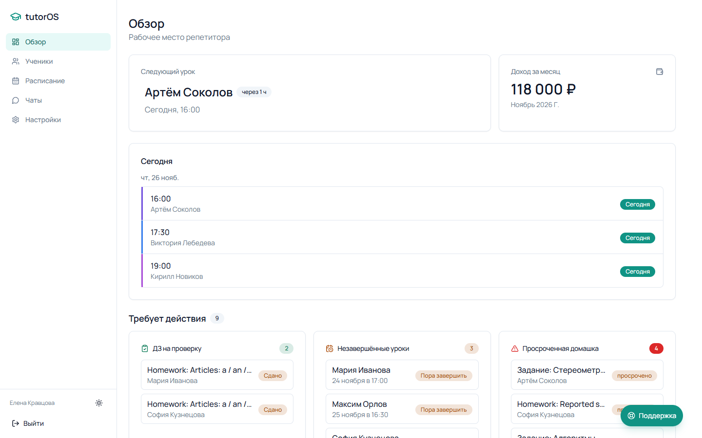
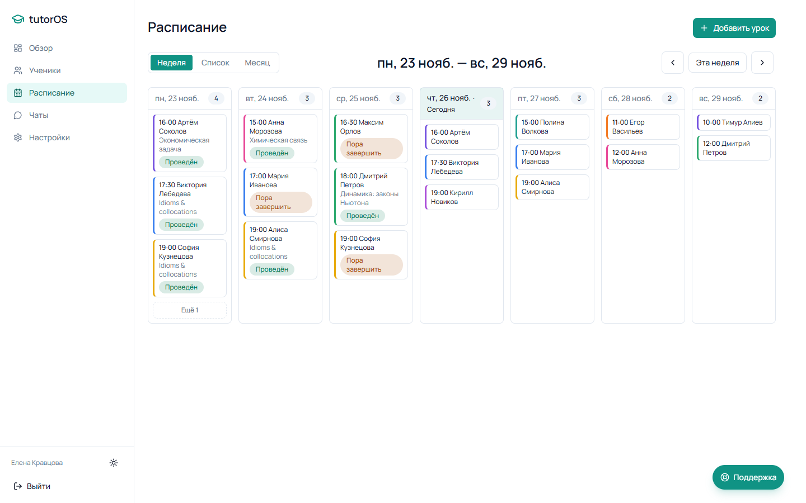
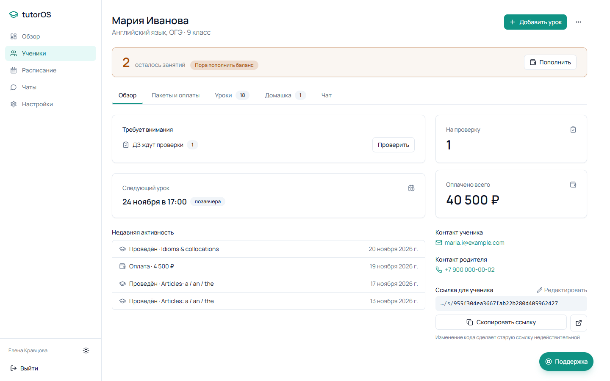
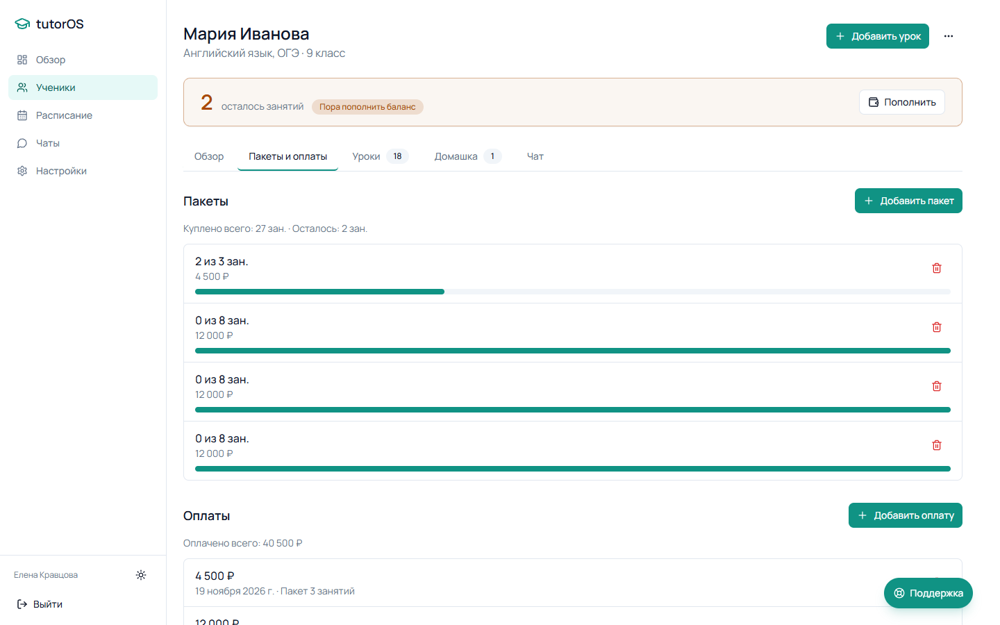
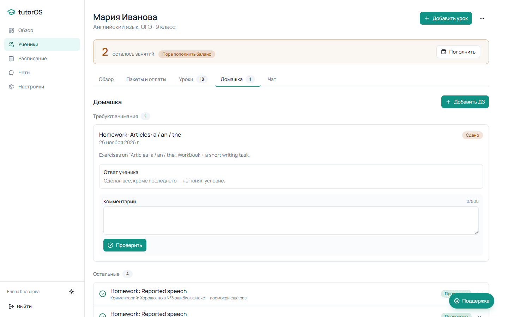
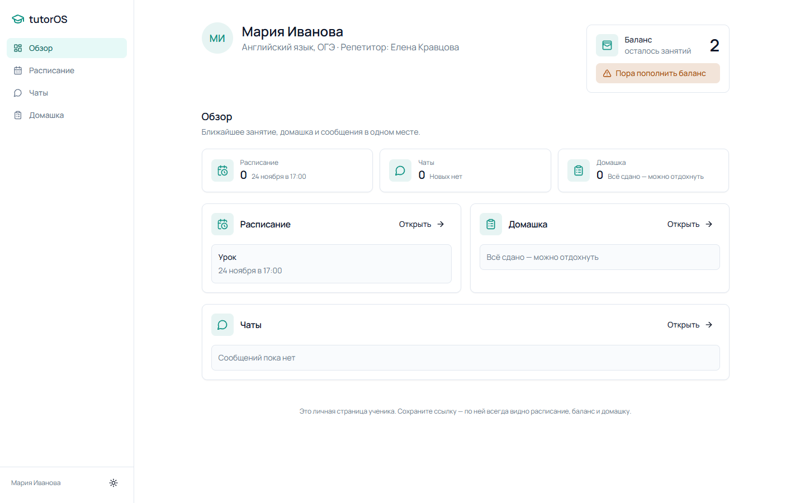

<h1 align="center">tutorOS</h1>

<p align="center">A workspace for solo tutors: lessons, payments, homework and a lesson balance that always adds up.</p>

<p align="center">
  
  
  
  
  
  <a href="https://github.com/nikito4kv/tutor-os-app/actions/workflows/ci.yml"></a>
</p>

<p align="center"></p>

> The interface is in Russian (the target audience is Russian-speaking tutors). Strings live in a single
> dictionary (`src/lib/i18n`), so adding a language is a data change, not a refactor.

## What it does

- **Student cards.** One page per student: lesson balance, upcoming lesson, recent activity, contacts, and a personal link the student opens without registering.
- **Lesson balance.** Tutors sell packages of lessons and record payments by hand (multi-currency per tutor). Completing a lesson deducts one from the oldest package; reopening it gives exactly that lesson back.
- **Schedule.** Week, list and month views. Recurring lessons are created as series (RRULE) and can be shifted as a group. Lessons that were held but never marked done are flagged as overdue.
- **Homework.** Assign tasks with attachments and deadlines, the student submits through their link, the tutor reviews and leaves feedback.
- **Chat.** A thread per student with file attachments and unread counters, no extra messenger needed.
- **Dashboard with an action inbox.** What needs attention right now: homework to review, unfinished lessons, overdue homework, students running out of lessons, income this month.
- **Notifications.** Telegram bot and email (Resend) for lesson and homework reminders; both run in mock mode locally until a key is configured.
- **Admin role.** A separate gated area for the developer: feedback inbox and platform-wide counters.

## Why it's interesting

- **A balance that cannot drift.** Money-adjacent logic lives in Postgres functions (`complete_lesson`, `reopen_lesson`, `create_lesson_series`), not in application code. Each completed lesson stores a "receipt" (`charged_package_id`), so a reopen refunds the exact package that was charged, and only if something was charged. Lesson rows are locked with `FOR UPDATE`, series creation is one transaction, and a double submit cannot double-charge. The requirements and edge cases are written up in [`docs/specs/balance-integrity`](docs/specs/balance-integrity/00_specification.md); a concurrency test completes two lessons in parallel against a real local database.
- **Authorization is enforced by the database, not just the UI.** Row-level security on every table; child tables carry a denormalised `tutor_id` (migration `0009`) so policies are an indexed comparison instead of a function call per row. Server code verifies the user with `auth.getUser()` rather than trusting the cookie, anonymous inserts to the feedback table are revoked (migration `0018`, covered by an RLS integration test), the cron endpoint accepts its secret only as a bearer header and compares it in constant time, and responses ship with security headers and a report-only CSP.
- **Built for ~100 concurrent users, with the reasoning on paper.** [`docs/specs/perf-100-users`](docs/specs/perf-100-users/00_specification.md) turns four hot spots into requirements: batched signed URLs for attachments instead of N+1 calls, one request-scoped, memoised auth lookup (`React.cache`) shared by the layout and the page, tab-scoped data fetching on the student card, and the RLS change above. The dashboard streams its cards independently with Suspense.
- **Decisions are recorded.** Six ADRs (stack, modal forms, admin role, admin directory, Telegram notifications, animation library) and nine specification folders show why things are the way they are.
- **Idempotent notifications without a queue.** Reminders are sent by an external cron hitting one endpoint; a unique `dedup_key` on the notification table makes repeated calls harmless, so no worker infrastructure is needed.

## Tech stack

| Layer     | Tools                                                                  |
| --------- | ---------------------------------------------------------------------- |
| App       | Next.js 15 (App Router, Server Actions), React 19, TypeScript (strict) |
| UI        | Tailwind CSS, shadcn/ui (Radix), Motion, react-day-picker              |
| Forms     | React Hook Form + Zod (the same schemas validate on the server)        |
| Data      | Supabase: Postgres, Auth, Storage, RLS, SQL migrations (18 so far)     |
| Messaging | Resend (email), Telegram Bot API                                       |
| Tooling   | pnpm, ESLint, Prettier, husky + lint-staged, GitHub Actions            |
| Testing   | Vitest (unit and DB integration), Playwright (e2e smoke)               |

## Screenshots

All frames are the real UI on fictional demo data (see [how they were captured](#how-the-screenshots-were-made)).

<table>
  <tr>
    <td width="50%"><br><sub><b>Schedule.</b> Week view; "Пора завершить" marks lessons that took place but are not closed yet.</sub></td>
    <td width="50%"><br><sub><b>Student card.</b> Balance banner, what needs attention, next lesson, share link for the student.</sub></td>
  </tr>
  <tr>
    <td width="50%"><br><sub><b>Packages and payments.</b> Remaining vs. purchased lessons per package, manual payment ledger.</sub></td>
    <td width="50%"><br><sub><b>Homework.</b> A submitted answer waiting for the tutor's review and comment.</sub></td>
  </tr>
  <tr>
    <td colspan="2"><br><sub><b>Student view.</b> Opened from a personal link, no account needed: balance, schedule, homework, chat.</sub></td>
  </tr>
</table>

## Quick start

Requirements: Node.js 22.13+ and pnpm (the exact version is pinned in `package.json`, so `corepack enable` is enough).

```bash
pnpm install
pnpm test                    # 200+ unit tests, no backend needed
```

To run the app you need a Supabase project (free tier is fine; step-by-step setup in [`docs/SETUP.md`](docs/SETUP.md), in Russian):

```bash
cp .env.example .env.local   # fill in the Supabase URL and keys
pnpm exec supabase link --project-ref <your-project-ref>
pnpm exec supabase db push   # applies supabase/migrations/*.sql
pnpm dev                     # http://localhost:3000
```

Email and Telegram stay in mock mode (messages are logged, nothing is sent) until their keys are set.

Optional: fill the account with a realistic tutor workload (12 fictional students, ~440 lessons, packages, payments, homework). It prints the demo login when it finishes and only touches that one demo account:

```bash
node --env-file=.env.local scripts/seed-active-tutor.mjs
```

### How the screenshots were made

Docker was not available on the machine used to prepare this repository, so a local Supabase could not be started. The screenshots come from the real app (`pnpm dev`, Chrome driven by Playwright, 1440×900) running against a throwaway in-memory HTTP stub that imitates the small subset of the Supabase REST and Auth API the app uses. The stub was filled by the repository's own `seed-active-tutor.mjs` script, so the data is fictional but internally consistent. The stub is not part of this repository.

## Project structure

```
src/
  app/(auth)/        sign-in, sign-up, password reset
  app/(app)/         tutor workspace: dashboard, students, schedule, messages, settings
  app/(admin)/       developer-only area (gated in the layout and by RLS/RPC)
  app/s/[token]/     student view opened from a personal link, no login
  app/api/           Telegram webhook, cron endpoint for reminders
  features/<area>/   schema.ts (Zod) · queries.ts (reads) · actions.ts (mutations) · UI
  lib/               config, Supabase clients, auth, i18n, date/currency helpers, security
supabase/migrations/ the single source of truth for schema, RLS and DB functions
tests/               unit, DB integration (parallel completion, RLS), e2e smoke
docs/                product, architecture, ADRs (decisions/), specs/, setup, user guide
scripts/             demo-data seeder, admin account creator
```

## Tests & quality

```bash
pnpm lint && pnpm typecheck  # ESLint (next/core-web-vitals) and tsc --noEmit
pnpm test                    # Vitest: 204 tests in 31 files
pnpm build                   # production build
pnpm e2e                     # Playwright smoke (needs a running app and Supabase env)
```

- Unit tests cover schemas, balance and payment arithmetic, auth redirects and server-side auth, cron secret handling, Telegram reminder windows and message templates, share-token rules, recurrence, overdue detection. Known past bugs have dedicated regression tests (`*.regression.test.ts`).
- Database integration tests (`pnpm test:integration`) run against a local Supabase in Docker: two lessons completed in parallel must charge two different packages, and the feedback table must reject anonymous inserts and bind authenticated ones to `auth.uid()`. See [`docs/TESTING.md`](docs/TESTING.md).
- CI (`.github/workflows/ci.yml`) runs lint, typecheck, unit tests and build in one job and the database integration tests, with a fresh local Supabase, in another. A husky pre-commit hook runs lint-staged.

## Status & roadmap

- **Done:** the accounting core (students, packages, payments, schedule with recurring series, homework, chat), student links, dashboard, Telegram and email notifications, admin role, onboarding tour.
- **Hardening:** a security review of authorization boundaries is done; further work on public forms, uploads and database constraints continues.
- **Next:** the lesson room (video through Daily.co plus a shared whiteboard) is designed but deliberately deferred until the accounting core is validated with real tutors.
- **Later:** parent portal, online payments, analytics, AI-assisted lesson notes. The full list is in [`docs/ROADMAP.md`](docs/ROADMAP.md); the Russian description of the project is in [`docs/README.ru.md`](docs/README.ru.md).

## License

MIT. See [LICENSE](LICENSE).

---

Built by [Nikita Lapa](https://github.com/nikito4kv) · built with an AI-assisted workflow
